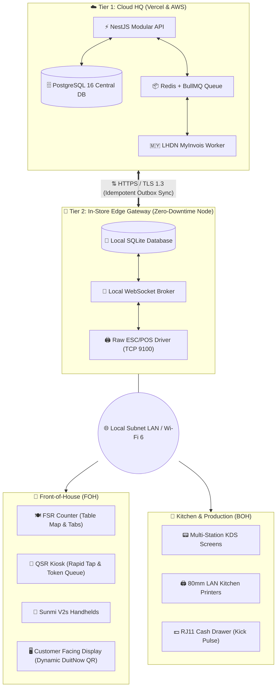

# System Architecture & Technical Specifications
## Nexus FnB Business Management System (Malaysia Edition)
**Document Version:** 1.0.0  
**Classification:** Single Source of Truth (SSOT)

---

### 1. Architectural Overview

Nexus FnB BMS implements an **Offline-First Hybrid Edge-and-Cloud Architecture**. 



---

### 2. Technology Stack Selection

| Tier | Technology | Justification |
| :--- | :--- | :--- |
| **Cloud Backend API** | **NestJS (TypeScript)** | Enterprise modularity, strict typing, dependency injection, and out-of-the-box Swagger/OpenAPI. |
| **Primary Database** | **PostgreSQL 16** | ACID compliance, JSONB support for recipe variants, rock-solid transactional safety for ledger data. |
| **Async Queues & Cache**| **Redis + BullMQ** | LHDN submission retries, bulk consolidated invoice generation, real-time WebSocket pub/sub. |
| **FOH POS Frontend** | **React / Vite / Tailwind** (or Electron for Windows / Flutter for Android) | Fast responsive rendering, low memory footprint, zero dependency on web browser print dialogs. |
| **QR Table Ordering**| **Next.js (App Router)** | Ultra-lightweight SSR/PWA, sub-second load times on mobile 4G/5G, no native app install required. |
| **KDS (Kitchen Display)**| **React Web App + WebSockets** | Real-time order bump bar interface with sound alerts and multi-station routing. |
| **Printing Driver** | **Raw ESC/POS Socket (TCP/IP & USB)** | Bypasses slow OS printer spoolers; sends raw byte streams directly to thermal heads with cutter & cash drawer pulses. |

---

### 3. Edge-to-Cloud Sync Protocol (Offline Resilience)

#### 3.1 Principle of Operation
1. **Local-First Writes**: When an order is created or paid at the outlet, the transaction is written first to the local SQLite database.
2. **Outbox Pattern**: An `outbox_events` table in SQLite logs mutation events:
   * `ORDER_CREATED`
   * `ORDER_ITEM_VOIDED`
   * `PAYMENT_COMPLETED`
   * `CASH_DRAWER_OPENED`
   * `SHIFT_CLOSED`
3. **Sync Daemon**:
   * A background worker polls the outbox and dispatches events to Cloud HQ via HTTPS batch endpoint (`/api/v1/sync/push`).
   * Cloud HQ acknowledges with processed IDs; local SQLite marks events as `synced: true`.
4. **Conflict Resolution**:
   * Master Data (Menu, Pricing, BOM, User Roles) flows strictly **Cloud $\rightarrow$ Outlet** (HQ is source of truth).
   * Transactional Data (Orders, Payments, Shifts) flows strictly **Outlet $\rightarrow$ Cloud** (Outlet is source of truth with UUID primary keys).

---

### 4. Database Schema Specification (DDL)

```sql
-- Schema: nexus_fnb
CREATE SCHEMA IF NOT EXISTS nexus_fnb;

-- 1. Organization & Outlets
CREATE TABLE nexus_fnb.outlets (
    id UUID PRIMARY KEY DEFAULT gen_random_uuid(),
    code VARCHAR(16) UNIQUE NOT NULL,       -- e.g. 'FSR-MY-01', 'QSR-KLCC-01'
    name VARCHAR(128) NOT NULL,
    outlet_type VARCHAR(8) NOT NULL CHECK (outlet_type IN ('FSR', 'QSR')),
    sst_registration_number VARCHAR(32),
    is_sst_enabled BOOLEAN DEFAULT TRUE,
    service_charge_percent NUMERIC(5,2) DEFAULT 10.00,
    has_central_kitchen_link BOOLEAN DEFAULT TRUE,
    address_line1 VARCHAR(255) NOT NULL,
    state VARCHAR(64) NOT NULL,
    postcode VARCHAR(10) NOT NULL,
    created_at TIMESTAMPTZ DEFAULT NOW(),
    updated_at TIMESTAMPTZ DEFAULT NOW()
);

-- 2. Halal & Health Tracking (Raw Materials)
CREATE TABLE nexus_fnb.ingredients (
    id UUID PRIMARY KEY DEFAULT gen_random_uuid(),
    sku VARCHAR(32) UNIQUE NOT NULL,
    name VARCHAR(128) NOT NULL,
    uom VARCHAR(16) NOT NULL,               -- 'KG', 'GRAM', 'LITER', 'ML', 'UNIT'
    current_cost_per_unit NUMERIC(10,4) NOT NULL,
    supplier_name VARCHAR(128) NOT NULL,
    is_halal_certified BOOLEAN DEFAULT TRUE,
    halal_cert_body VARCHAR(64),            -- 'JAKIM', 'MUIS', 'CICOT', etc.
    halal_cert_number VARCHAR(64),
    halal_cert_expiry DATE,
    shelf_life_days INT DEFAULT 7,
    created_at TIMESTAMPTZ DEFAULT NOW()
);

-- 3. Menu Items & Recipe Bill of Materials (BOM)
CREATE TABLE nexus_fnb.menu_items (
    id UUID PRIMARY KEY DEFAULT gen_random_uuid(),
    sku VARCHAR(32) UNIQUE NOT NULL,
    name VARCHAR(128) NOT NULL,
    category VARCHAR(64) NOT NULL,          -- 'MAINS', 'BEVERAGES', 'SIDES', 'DESSERT'
    base_price NUMERIC(10,2) NOT NULL,
    kitchen_station VARCHAR(32) NOT NULL,   -- 'HOT_KITCHEN', 'DRINK_BAR', 'COLD_PREP'
    is_active BOOLEAN DEFAULT TRUE,
    packaging_fee NUMERIC(5,2) DEFAULT 0.00
);

CREATE TABLE nexus_fnb.recipe_bom (
    id UUID PRIMARY KEY DEFAULT gen_random_uuid(),
    menu_item_id UUID REFERENCES nexus_fnb.menu_items(id) ON DELETE CASCADE,
    ingredient_id UUID REFERENCES nexus_fnb.ingredients(id),
    quantity_required NUMERIC(10,4) NOT NULL, -- e.g. 0.150 KG chicken
    wastage_allowance_percent NUMERIC(5,2) DEFAULT 5.00
);

-- 4. Floor & Table Management (FSR Only)
CREATE TABLE nexus_fnb.dining_tables (
    id UUID PRIMARY KEY DEFAULT gen_random_uuid(),
    outlet_id UUID REFERENCES nexus_fnb.outlets(id),
    table_number VARCHAR(16) NOT NULL,
    section VARCHAR(32) DEFAULT 'MAIN_DINING', -- 'INDOOR', 'OUTDOOR', 'VIP'
    capacity INT DEFAULT 4,
    status VARCHAR(16) DEFAULT 'VACANT' CHECK (status IN ('VACANT', 'SEATED', 'ORDERED', 'SERVED', 'BILL_OUT')),
    active_order_id UUID,
    UNIQUE(outlet_id, table_number)
);

-- 5. Orders & Financial Transactions
CREATE TABLE nexus_fnb.orders (
    id UUID PRIMARY KEY DEFAULT gen_random_uuid(),
    outlet_id UUID REFERENCES nexus_fnb.outlets(id),
    order_number VARCHAR(32) NOT NULL,      -- 'FSR-20261109-001'
    queue_token INT,                        -- 101, 102 for QSR
    table_id UUID REFERENCES nexus_fnb.dining_tables(id),
    order_mode VARCHAR(16) NOT NULL CHECK (order_mode IN ('DINE_IN', 'TAKEAWAY', 'DELIVERY')),
    
    -- Subtotals & Malaysian Taxation
    subtotal_gross NUMERIC(10,2) NOT NULL,
    discount_total NUMERIC(10,2) DEFAULT 0.00,
    service_charge_amount NUMERIC(10,2) DEFAULT 0.00, -- 10%
    sst_amount NUMERIC(10,2) DEFAULT 0.00,            -- 6%
    rounding_adjustment NUMERIC(5,2) DEFAULT 0.00,   -- BNM 5-sen rule
    total_payable NUMERIC(10,2) NOT NULL,
    
    -- Payment & Settlement
    payment_method VARCHAR(24),            -- 'DUITNOW_QR', 'CASH', 'CREDIT_CARD', 'TNG_EWALLET'
    payment_status VARCHAR(16) DEFAULT 'PENDING' CHECK (payment_status IN ('PENDING', 'PAID', 'VOIDED', 'REFUNDED')),
    
    -- LHDN Compliance Metadata
    lhdn_status VARCHAR(16) DEFAULT 'PENDING' CHECK (lhdn_status IN ('PENDING', 'VALIDATED', 'CONSOLIDATED', 'EXEMPT')),
    lhdn_uuid VARCHAR(64),
    lhdn_validation_url TEXT,
    
    created_at TIMESTAMPTZ DEFAULT NOW(),
    closed_at TIMESTAMPTZ
);
```

---

### 5. Hardware Interfacing & ESC/POS Protocol

Printing to thermal printers is done via standard raw byte stream over port 9100 (Direct RAW TCP):

```
+-------------------------------------------------------+
|                 ESC/POS Byte Sequence                 |
+-------------------------------------------------------+
| 1B 40          : Initialize Printer                   |
| 1B 61 01       : Justify Center                       |
| 1D 21 11       : Double Height & Width (Brand Header) |
| [Text]         : "NEXUS F&B RESTAURANT"               |
| 1B 61 00       : Justify Left                         |
| [Text]         : Table: T04 | Cashier: Ali            |
| ----------------------------------------------------- |
| [Text]         : 1x Nasi Lemak Royale      RM 18.90   |
| [Text]         : 1x Teh Tarik Kaw          RM  4.50   |
| ----------------------------------------------------- |
| [Text]         : Subtotal:                 RM 23.40   |
| [Text]         : 10% Service Charge:       RM  2.34   |
| [Text]         : 6% Service Tax (SST):     RM  1.54   |
| [Text]         : 5-Sen Rounding:          +RM  0.02   |
| 1D 21 01       : Bold Total                           |
| [Text]         : TOTAL (CASH):             RM 27.30   |
| 1D 56 41 00    : Full Paper Cut                       |
| 10 14 01 00 05 : Pulse RJ11 Cash Drawer Pin           |
+-------------------------------------------------------+
```
