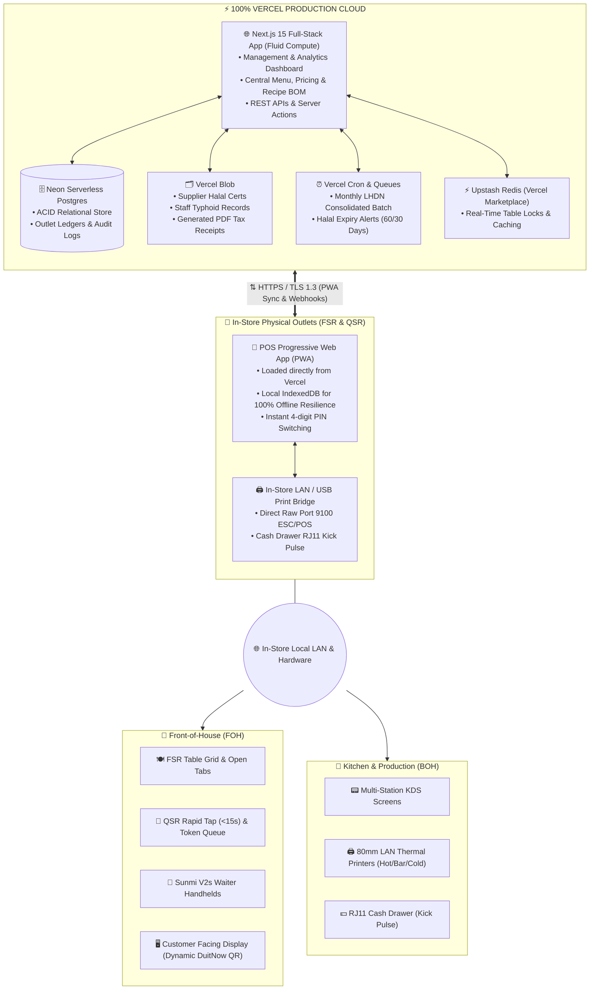

# System Architecture & Technical Specifications
## Nexus FnB Business Management System (Malaysia Edition)
**Document Version:** 2.0.0 (100% Vercel Production Native)  
**Classification:** Single Source of Truth (SSOT)

---

### 1. Architectural Overview

Nexus FnB BMS implements a **100% Vercel-Native Serverless Production Architecture** paired with an **In-Store Offline-First PWA Engine**.

> [!IMPORTANT]
> **Zero External Cloud Virtual Machines**: Final production is strictly deployed on **Vercel** and its managed ecosystem (Neon Postgres, Vercel Blob, Vercel Cron, Upstash Redis). No AWS EC2, GCP compute instances, or dedicated Linux VPS servers are required.

---

### 2. Technology Stack Selection

| Tier / Component | Technology | Production Justification & Function |
| :--- | :--- | :--- |
| **Cloud Hosting & Full-Stack Core** | **Next.js 15 on Vercel (Fluid Compute)** | Eliminates AWS/VPS completely. Automatic scaling during peak lunch/dinner rushes. Unified codebase for APIs, Server Actions, and SSR Dine-In QR menus. |
| **Primary Relational Database** | **Neon Postgres (Vercel Marketplace)** | Serverless PostgreSQL with auto-scaling, point-in-time recovery, connection pooling, and zero idle-server maintenance. |
| **Statutory Batch Workers** | **Vercel Cron & Serverless Functions** | Automates end-of-month LHDN MyInvois B2C consolidated batch generation and 60-day supplier Halal certification expiration alerts. |
| **Compliance & Document Storage** | **Vercel Blob** | Secure cloud storage for supplier Halal certificates, employee typhoid vaccination records (*Suntikan Tifoid*), and generated PDF tax invoices. |
| **Session Locks & Cache** | **Upstash Redis (Vercel Marketplace)** | Millisecond table-locking (prevents double-seating across waiter handhelds) and cashier float cache. |
| **In-Store POS Terminal** | **Next.js PWA + IndexedDB** | Runs directly in Chrome/Edge on Windows, iPad, or Sunmi/iMin POS terminals. 100% operational offline when local ISP fibre drops. |
| **Thermal Printing Driver** | **In-Store Local Bridge / WebUSB** | Lightweight native bridge dispatching raw ESC/POS bytes over TCP port 9100 directly to 80mm kitchen/receipt printers and cash drawers. |

---

### 3. Edge-to-Cloud Sync Protocol (Offline Resilience)

1. **Local-First Writes**: When an order is created or paid at the outlet, the transaction is written first to the local IndexedDB database.
2. **Outbox Pattern**: An `outbox_events` table logs mutation events: `ORDER_CREATED`, `ORDER_ITEM_VOIDED`, `PAYMENT_COMPLETED`, `CASH_DRAWER_OPENED`, `SHIFT_CLOSED`.
3. **Sync Daemon**: When internet connectivity is active, pending events are streamed to Vercel via `/api/sync/push`. Vercel commits to Neon Postgres and acknowledges processed IDs.
4. **Conflict Resolution**: Master Data (Menu, Pricing, BOM) flows **Cloud $\rightarrow$ Outlet**. Transactional Data flows **Outlet $\rightarrow$ Cloud**.
